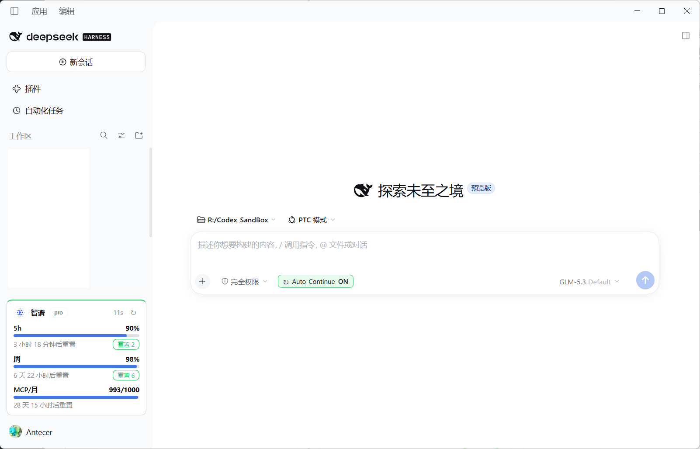
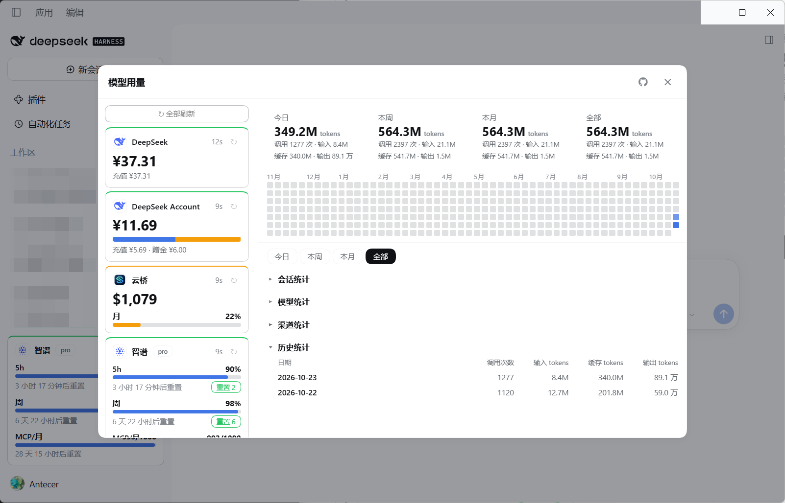

# dsh-model-usage

DSH（DeepSeek Harness）Web 插件：在侧栏底部常驻显示模型供应商的额度与本机用量，点击打开双列详情弹窗。

作者：Antecer · 许可：MIT

## 截图

侧栏底部常驻入口（供应商卡片）：



点击卡片打开双列详情弹窗：



## 功能

- **侧栏底部入口**：跟随当前前台对话供应商（新建对话立即跟随 DSH 默认模型），展示图标、名称与额度摘要；无识别结果时展示状态最紧急的供应商
- **账号菜单联动**：左下角账号菜单弹出时自动隐藏侧栏卡片、菜单关闭后恢复，避免卡片遮挡向上弹出的菜单
- **冷启动首屏**：上次快照缓存到 localStorage 供冷启动立即回显（标「已过期」），首次快照返回前先渲染骨架卡片，请求失败自动退避重试，避免 DSH 冷启动后侧栏底部长时间空白
- **峰谷时段提示**：DeepSeek 官方卡片底部显示当前峰/谷与距下次切换的时长（工作日 9:00–12:00、14:00–18:00 为高峰，其余含周末/法定节假日全天空闲）；节假日表自动从 timor.tech 拉取，Host 每 12h 校验官方价格表，配置不一致时弹窗提醒
- **双列详情弹窗**：左列供应商卡片（独立刷新），右列固定摘要 + 统计（限高 74vh，下半滚动）
- **右栏固定摘要**：今日 / 本周 / 本月 / 全部四张统计卡 + 近 12 个月用量热力图（悬停实测钳位提示）
- **四个统计分区**：会话统计 → 模型统计（行可展开每次调用）→ 渠道统计 → 历史统计（按日新到旧）；统一信息列「调用次数 / 输入 tokens / 缓存 tokens / 输出 tokens」，范围可选今日 / 本周 / 本月 / 全部（日历口径），UI 偏好（范围与各分区展开态）经 localStorage 持久化
- **额度数据**：服务商接口返回的真实余额 / 剩余额度 / 订阅窗口（按 5h → 日 → 周 → 月排列）与重置倒计时、余量配色（≥60% 蓝 / ≥30% 绿 / ≥5% 橘 / <5% 亮红）
- **GLM Coding Plan 额度重置**（ZCode 同款）：与 ZCode 客户端共享登录凭据，5h/周窗口显示「重置 N」按钮，点击弹出「可重置额度」弹窗（当前额度卡片 + 重置行，二次确认即核销）；未登录 ZCode 时可内嵌 OAuth 登录并回写共享凭据
- **sub2api 中继自动识别**：从 DSH profile 读取供应商 baseURL 与凭据引用，自动探测 `GET /v1/usage`，无需手动配置
- **零配置凭据复用**：查询模板按 profile 中的 baseURL 自动匹配（host 精确匹配），凭据直接复用 provider 的 `apiKeyEnv`，多账号互不串号；`credentials` / `adapters` 只在需要覆盖默认行为时才配置。插件 Host 进程没有 profile 环境变量时，按当前 llm 路由命中数自动识别正在运行的 profile
- **模板字符串**：卡片摘要可用 `card.template` 自定义排列

## 安装

要求 DSH `>= 0.2.0-rc.2 < 0.3.0`。

### 从插件市场安装（推荐）

1. 打开「插件 → 实验性插件 → 更多 → 自定义插件市场」，启用后在「发现」里点「添加索引源」。
2. 粘贴索引地址：

```
https://antecer.github.io/dsh-model-usage/index.json
```

3. 搜索 `Model Usage` 并安装。

### 从 npm 安装

```bash
dsh plugin --profile <profile> add @antecer/dsh-model-usage
```

### 从 Git 安装（固定提交）

```bash
dsh plugin --profile <profile> add "git+https://github.com/Antecer/dsh-model-usage.git#d90145bd58c63a47cb7d6b62c1a9ef1f4e6f957c"
```

### 从本地源码安装（开发）

```bash
dsh plugin --profile <profile> add link:/path/to/dsh-model-usage
```

安装后重启宿主并刷新页面。发布、索引维护与社区市场提交见 [docs/publish-market.md](docs/publish-market.md)。

## 改动生效方式

- **`lib/client.js`（界面）**：刷新页面即可
- **`lib/index.mjs` / `lib/adapters.mjs` / `lib/profile.mjs` / `lib/ledger.mjs` / `lib/zcode/*.mjs`（Host 取数、账本与 GLM 重置）**：在插件列表里重启本插件即可，无需重启整个应用
- **profile 配置（`cordis.patch.yml`）**：插件侧 60 秒内自动感知；聊天侧的 provider 变更需重载宿主

## 供应商支持

| 供应商 | 接口 | 展示 |
|---|---|---|
| DeepSeek API | `api.deepseek.com/user/balance` | 余额（总/充值/赠金） |
| DeepSeek 账号 | DSH `deepseekAccount` 服务 | 账号钱包 |
| GLM Coding Plan | `open.bigmodel.cn` / `api.z.ai` 额度接口 | 5h / 周 / 每月 MCP 次数 |
| Kimi Coding | `api.kimi.com/coding/v1/usages` | 周 + 滚动窗口 |
| Moonshot / Kimi 平台 | `api.moonshot.{ai,cn}/v1/users/me/balance` | 余额 |
| OpenRouter | `openrouter.ai/api/v1/credits` | credits 余额 |
| MiniMax Token Plan | `api.minimax.io` / `api.minimaxi.com` `/v1/token_plan/remains` | 5h + 周 |
| OpenCode Go | `opencode.ai/zen/go/v1/usage` | 5h / 周 / 月 |
| 小米 MiMo | `platform.xiaomimimo.com/api/v1/balance` | 余额 |
| GitHub Copilot | `api.github.com/copilot_internal/user` | Premium / Chat / 补全配额 |
| **sub2api 中继** | `{baseURL}/v1/usage`（自动识别） | 剩余额度 / 速率窗口 / 订阅限额 / 余额 |

没有公开额度接口的供应商（OpenAI、Anthropic 等）自动隐藏，不报错。

## 配置

`cordis.patch.yml` 中 `model-usage` 行的 `config`：

| 键 | 默认 | 说明 |
|---|---|---|
| `refreshSeconds` | 60 | 额度刷新间隔（秒，最小 1） |
| `footer` | true | 是否显示侧栏底部入口 |
| `credentials` | `{}` | 按路由覆盖凭据引用（可选；缺省复用 provider 在 profile 中的 `apiKeyEnv`） |
| `adapters` | `{}` | 按路由显式指定查询模板（可选；缺省按 profile 的 baseURL 自动识别，见下） |
| `sub2api` | `{}` | 按路由显式指定 sub2api 端点：`{ baseURL, keyRef }`（缺省自动从 profile 探测） |
| `glm` | `{}` | GLM 高级参数：`organization` / `project` / `planType` |
| `card.template` | `""` | 卡片摘要模板字符串（见下） |
| `pricing` | 官方默认值 | DeepSeek 峰谷规则与单价：`peakDays` / `peakWindows` / `models`（元/百万 tokens），用于卡片峰谷提示与官方价格校验 |

### 适配器自动识别

查询模板按以下优先级解析：**`adapters` 显式指定 → profile 中 provider 的 `baseURL` 匹配内置模板（host 精确匹配）→ 内置路由名匹配 → sub2api 探测**。

内置模板覆盖 Kimi Coding（`api.kimi.com/coding/*`）、Moonshot、GLM Coding（`api.z.ai` / `open.bigmodel.cn`）、DeepSeek、OpenRouter、MiniMax、OpenCode Go、小米 MiMo 等。用量接口地址与响应解析都内置在插件代码里，profile 中的 provider 只需有 `baseURL` + `apiKeyEnv` 即可显示额度，无需在插件配置里重复书写凭据。

凭据引用优先级：`credentials` 显式覆盖 > provider 自己的 `apiKeyEnv`（一旦配置即为唯一来源，不回退到共享默认值，多账号不串号）> 适配器默认环境变量 > 路由名派生。

### 卡片模板

```yaml
config:
  card:
    template: "{name} 剩 {remaining}（{window} {leftPct}）"
```

可用变量：`{name}` `{route}` `{plan}` `{remaining}` `{limit}` `{used}` `{usedPct}` `{window}` `{leftPct}` `{resetIn}` `{balance}` `{currency}`。

默认布局（不配置模板时）按 **剩余额度 → 订阅窗口 → 余额** 的顺序自动选择，即优先剩余模式，API 没有剩余数据时退化到余额模式。

### 峰谷提示与官方价格校验

DeepSeek 官方计费按北京时间分峰谷（空闲价 = 高峰价的一半）：**周一至周五 9:00–12:00、14:00–18:00 为高峰**，其余时段（含周末与中国法定节假日全天）为空闲。插件在 **DeepSeek 官方供应商卡片**上做峰谷提示（侧栏卡片与详情弹窗左列卡片一致，仅 DeepSeek 生效）：

- 中间大数字按当前时段着色：**高峰红色、空闲绿色**；鼠标悬停在**大数字文字**上时在指针上方显示自绘提示「当前时段：梁文峰 / 梁文谷」（左下角对齐指针、与热力图提示同款气泡；仅文字区域触发，整行空白不弹出）；
- 倒计时与「充值 / 赠金」说明**同一行右对齐**，只显示距下次切换的时长（如 `2h`、`1h30m`、`45m`）；
- 非 DeepSeek 供应商（Kimi / GLM 等）不做峰谷提示。

规则与单价内置在 `pricing` 配置里（可覆盖），默认值即当前官方价：

```yaml
config:
  pricing:
    peakDays: [1, 2, 3, 4, 5]
    peakWindows:
      - ['09:00', '12:00']
      - ['14:00', '18:00']
    models:
      deepseek-flash:
        cacheHit: { peak: 0.04, offPeak: 0.02 }
        cacheMiss: { peak: 2, offPeak: 1 }
        output: { peak: 8, offPeak: 4 }
      deepseek-v4-pro:
        cacheHit: { peak: 0.3, offPeak: 0.15 }
        cacheMiss: { peak: 9, offPeak: 4.5 }
        output: { peak: 27, offPeak: 13.5 }
```

- **节假日表**：来自免费接口 `https://timor.tech/api/holiday/year/<年>`（只发送年份，不含任何用户数据），Host 侧缓存 24h；接口不可用时降级为「仅周末」规则。
- **官方价格校验**：Host 每 12h 抓一次官方中文定价页并与 `pricing` 比对；发现价格或时段差异时，页面刷新后弹窗列出「配置值 → 官方值」，修改 `cordis.patch.yml` 后重启插件生效。关闭弹窗会记住该差异，不再重复打扰。
- 价格单位是**元 / 百万 tokens**（官方中文页报价）；页面改版导致解析失败时不弹「变动」提示，只静默重试。

## 数据口径

- **额度**：服务商接口返回的真实值（剩余额度 / 余额 / 窗口已用百分比）
- **本机用量**：`assistant/message` 事件中服务商回传的 usage（input + cacheRead + cacheWrite + output；tokens = 四项合计，缓存 tokens = cacheRead + cacheWrite）
- **统计维度**：按供应商/模型（渠道、模型统计）、按会话（记录会话 id，标题经 sessions 服务实时解析）、按日（历史统计，新到旧）
- **统计范围**：今日 / 本周（周一起）/ 本月（1 号起）/ 全部；本机、插件启用后写入会话日志的调用；其他设备与旁路调用不计
- 账本文件：`$DSH_HOME/model-usage/ledger.json`（按日聚合保留 **180 天**，加载时自动迁移旧版格式；热力图读取最近 364 天）
- **不做金额估算**：订阅套餐按套餐额度计费，金额以服务商账单为准（`pricing` 单价仅用于峰谷提示与官方价格校验，不用于账单估算）

## 安全

- API Key 只在 Host 内存中解析使用，不进入浏览器，任何 RPC 响应都不含密钥
- 内置适配器只请求写死的服务商域名；sub2api 探测只访问 profile 中用户自己配置的供应商 baseURL
- 错误信息脱敏（`sk-*` / `Bearer *` 等凭据形态会被打码）
- 账本只存用量聚合数字，不含对话内容

## 开发

```bash
node --check lib/index.mjs lib/adapters.mjs lib/profile.mjs lib/ledger.mjs lib/zcode/*.mjs lib/client.js
node --test test/
```

注意：插件客户端必须单文件交付（DSH ModuleLoader 按包名注册模块，不支持相对路径 require），浏览器侧只有 `lib/client.js` 一个文件，`trackCurrentRoute`（会话跟随）与 `createTicker`（秒级 ticker）等逻辑直接内联其中，即唯一实现；client 测试通过抽取内联函数的方式直接回归发布产物。Host 侧文件统一使用 `.mjs` 后缀，与浏览器脚本区分。

架构与 API 查询方式详见 [docs/architecture.md](docs/architecture.md)。
