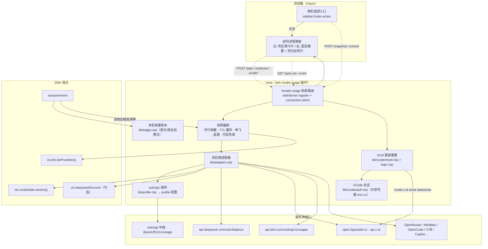
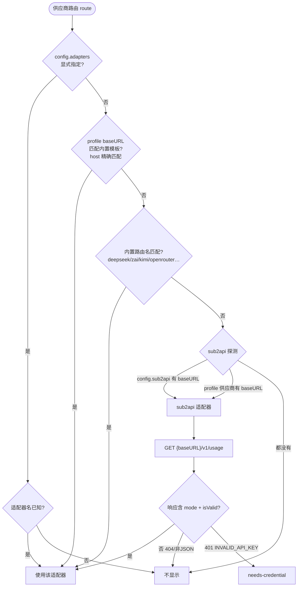
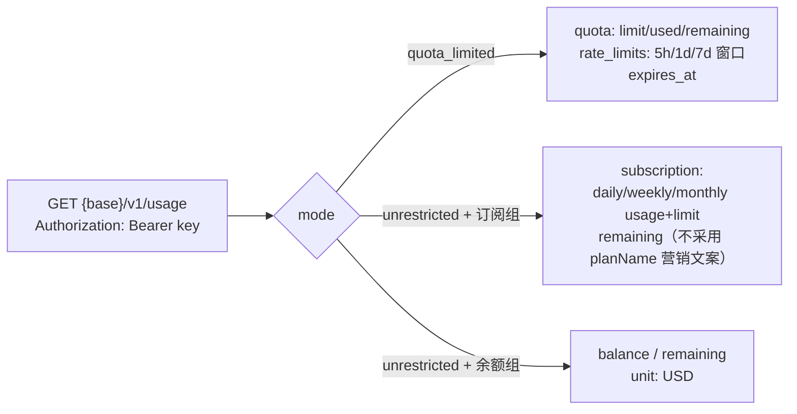
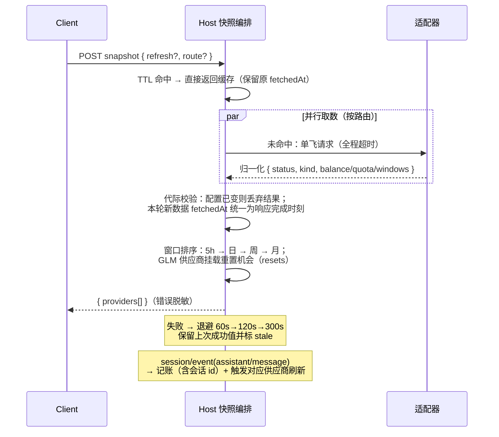
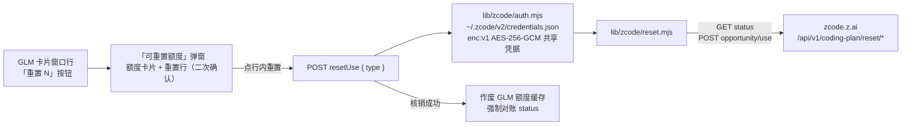

# dsh-model-usage 架构

> DSH Web 插件：Host（Node）负责取数与缓存，Client（浏览器）负责展示。
> 跨端数据走带认证的 `/model-usage` 前缀路由；凭据只在 Host 内存。

## 整体结构



## 适配器解析流程



凭据引用优先级：`config.credentials[route]` 显式覆盖 > provider 在 profile 中的 `apiKeyEnv`（存在即唯一来源，多账号不串号）> 适配器默认环境变量 > 路由名派生。

## sub2api 协议（GET {baseURL}/v1/usage，Bearer 认证）



解析口径（与 sub2api 官方 CC Switch 脚本一致）：`remaining ?? quota.remaining ?? balance`，`unit ?? "USD"`。

## 内置适配器查询方式

| 适配器 | 请求 | 认证 | 关键响应字段 |
|---|---|---|---|
| deepseek-balance | `GET api.deepseek.com/user/balance` | Bearer | `balance_infos[]`（total/granted/topped_up） |
| deepseek-account | `ctx.deepseekAccount.getBalance()` | DSH 登录态 | `value[] / bonusWallets[]` |
| glm-coding | `GET {host}/api/monitor/usage/quota/limit` | raw key（401 回退 Bearer） | `data.limits[]` 按 type+unit 选窗口；nextResetTime 兼容秒级/ISO 字符串，MCP/月缺省时按次月 1 日 00:00 UTC 补算；0% 滚动窗无重置时间属正常（调用后开始计时） |
| kimi-coding | `GET api.kimi.com/coding/v1/usages` | Bearer | `usage`（周）+ `limits[].detail`（滚动） |
| moonshot-balance | `GET api.moonshot.{ai,cn}/v1/users/me/balance` | Bearer | `data.available_balance` |
| openrouter | `GET openrouter.ai/api/v1/credits`（兜底 `/key`） | Bearer | `total_credits - total_usage` |
| minimax-plan | `GET {host}/v1/token_plan/remains` | Bearer | `*_remaining_percent` |
| opencode-go | `GET opencode.ai/zen/go/v1/usage` | Bearer | `usage.{rolling,weekly,monthly}.percent` |
| xiaomi-balance | `GET platform.xiaomimimo.com/api/v1/balance` | Bearer | `balance` |
| github-copilot | `GET api.github.com/copilot_internal/user` | Bearer | `quota_snapshots.*` |

## 快照生命周期



## RPC 端点（POST /model-usage，body { endpoint, payload }）

| endpoint | 说明 |
|---|---|
| `snapshot` | 额度快照；`{refresh: true, route?}` 强制刷新（可限定路由） |
| `stats` | 本机用量统计；`{days}` 或 `{scope: 'week'\|'month'}`（日历口径） |
| `current` | 最近一次真实模型调用的供应商（前端跟随兜底） |
| `config` | refreshSeconds / footer / card.template |
| `resetUse` | GLM 额度核销；`{type: 'FIVE_HOUR'\|'WEEK'}`（幂等，失败复用同一 key） |
| `zcodeAuthState` | ZCode 会话连接状态（重置功能用） |
| `zcodeLoginStart / zcodeLoginComplete / zcodeDisconnect` | 内嵌 OAuth 登录 / 断开（共享凭据） |

## GLM 额度重置链路（ZCode 同款）



- **凭据共享**：存储路径与格式与 ZCode 客户端完全一致（enc:v1，密钥由本机信息推导）；ZCode 已登录即开即用，插件内嵌 OAuth 登录（lib/zcode/login.mjs，授权码手动粘贴回调）写回同一文件，双向共用登录态
- **机会状态**：GET /status（5 分钟 TTL 缓存）；无有效机会时 POST /opportunity 触发服务端资格判断（3301 限流按 next_try_at 冷却）
- **鉴权**：`Authorization: Bearer <zcodeJwt>` + `X-Bigmodel-Authorization: <业务JWT>`（直传不套 Bearer），PERSONAL scope
- **401**：视为会话失效，前端提示经 GLM 卡片 Logo（账户入口）重新连接

## 配置结构

```yaml
- id: model-usage
  name: dsh-model-usage
  config:
    refreshSeconds: 60        # 刷新间隔
    footer: true              # 侧栏入口
    credentials: {}           # 按路由覆盖凭据引用（可选；缺省复用 provider 的 apiKeyEnv）
    adapters: {}              # 按路由显式适配器（可选；缺省按 baseURL 自动识别模板）
    sub2api: {}               # 按路由显式 sub2api 端点 { baseURL, keyRef }
    glm: {}                   # GLM organization / project / planType
    card:
      template: ""            # 卡片摘要模板字符串
```

## 安全边界

1. 凭据只在 Host 内存；RPC 响应不含密钥，错误信息统一脱敏
2. 内置适配器只请求写死域名；sub2api 只访问 profile 中用户自己配置的 baseURL（凭据本就会发往该地址）
3. 静态资源（style.css / icons）只读包内固定路径，slug 白名单字符
4. 账本只存聚合数字，不含对话内容
