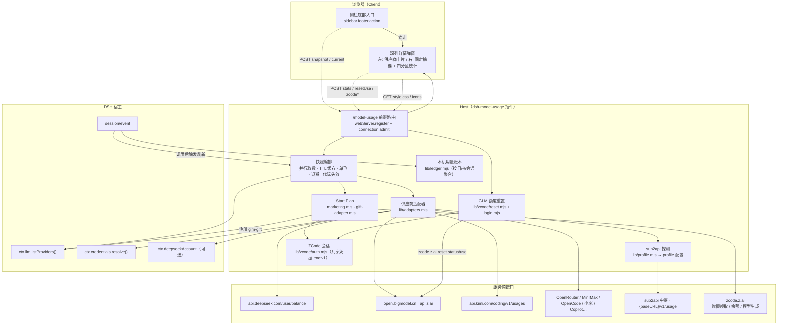
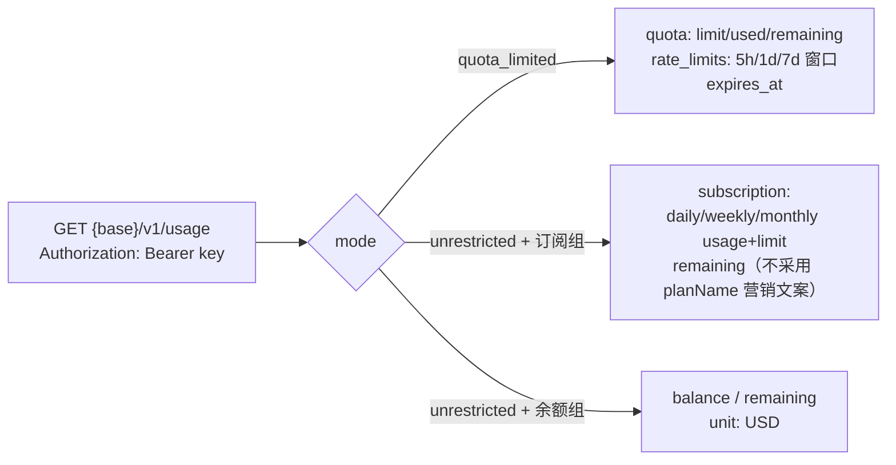
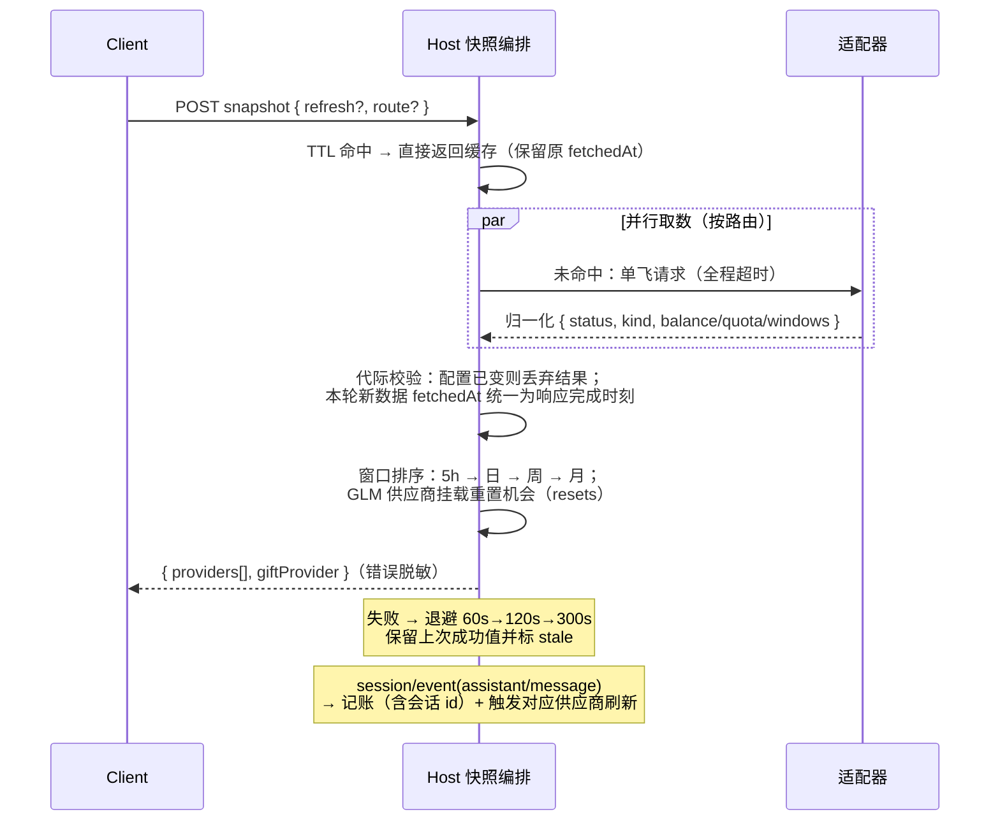
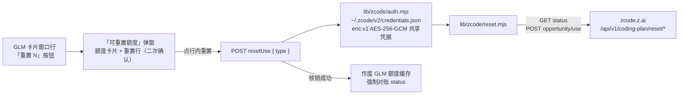

# dsh-model-usage 架构

> DSH Web 插件：Host（Node）负责取数与缓存，Client（浏览器）负责展示。
> 跨端数据走带认证的 `/model-usage` 前缀路由；凭据仅在 Host 解析和使用，ZCode 会话沿用本机加密凭据文件。

## 整体结构



## 适配器解析流程


凭据引用优先级：`config.credentials[route]` 显式覆盖 > provider 在 profile 中的 `apiKeyEnv`（存在即唯一来源，多账号不串号）> 适配器默认环境变量 > 路由名派生。

[profile.mjs](../lib/profile.mjs) 优先使用 Host 当前 profile 目录，其次兼容 `DSH_PROFILE_DIR` / `DSH_PROFILE`；均缺失时才扫描并按路由命中数选择，最高分并列返回空表。先读基础配置，再按字段合并 patch。缓存按明确目录，或扫描根目录与路由集合隔离，避免同名路由从另一 profile 取得凭据引用。

## sub2api 协议（GET {baseURL}/v1/usage，Bearer 认证）



解析口径（与 sub2api 官方 CC Switch 脚本一致）：`remaining ?? quota.remaining ?? balance`，`unit ?? "USD"`。

## 内置适配器查询方式

| 适配器 | 请求 | 认证 | 关键响应字段 |
|---|---|---|---|
| deepseek-balance | `GET api.deepseek.com/user/balance` | Bearer | `balance_infos[]`（total/granted/topped_up） |
| deepseek-account | `ctx.deepseekAccount.getBalance()` | DSH 登录态 | `value[] / bonusWallets[]` |
| glm-coding | `GET {host}/api/monitor/usage/quota/limit` | raw key（401 回退 Bearer） | `data.limits[]` 按 type+unit 选窗口；nextResetTime 兼容秒级/ISO 字符串，MCP/月缺省时按次月 1 日 00:00 UTC 补算；0% 滚动窗无重置时间属正常（调用后开始计时） |
| kimi-coding | `GET api.kimi.com/coding/v1/usages` | Bearer | `usage`（周）+ `limits[].detail`（滚动）；`usages` 补月度配额与周窗口兜底 |
| moonshot-balance | `GET api.moonshot.{ai,cn}/v1/users/me/balance` | Bearer | `data.available_balance` |
| openrouter | `GET openrouter.ai/api/v1/credits`（兜底 `/key`） | Bearer | `total_credits - total_usage` |
| minimax-plan | `GET {host}/v1/token_plan/remains` | Bearer | `*_remaining_percent` |
| opencode-go | `GET opencode.ai/zen/go/v1/usage` | Bearer | `usage.{rolling,weekly,monthly}.percent` |
| xiaomi-balance | `GET platform.xiaomimimo.com/api/v1/balance` | Bearer | `balance` |
| github-copilot | `GET api.github.com/copilot_internal/user` | Bearer | `quota_snapshots.*` |

## 快照生命周期



## RPC 端点（POST /model-usage，body { endpoint, payload }）

| endpoint | 说明 |
|---|---|
| `snapshot` | 额度快照；`{refresh: true, route?}` 强制刷新（可限定路由） |
| `stats` | 本机用量统计；`{days}` 或 `{scope: 'week'\|'month'}`（日历口径） |
| `current` | 最近一次真实模型调用的供应商（前端跟随兜底） |
| `config` | refreshSeconds / footer / card.template |
| `resetUse` | GLM 额度核销；`{type: 'FIVE_HOUR'\|'WEEK'}`（幂等，失败复用同一 key） |
| `zcodeAuthState` | ZCode 会话连接状态（重置与赠额共用） |
| `zcodeLoginStart / zcodeLoginComplete / zcodeDisconnect` | 内嵌 OAuth 登录 / 断开（共享凭据） |
| `claimOffer` | 领取当前投放的赠额套餐，随后重新查询余额与候选模型 |
| `pricingEnv / pricingCheck` | 峰谷规则与官方价格比对 |
| `versionCheck / updatePlugin` | 查询版本与请求插件更新 |

## GLM 额度重置链路（ZCode 同款）



- **凭据共享**：存储路径与格式与 ZCode 客户端完全一致（enc:v1，密钥由本机信息推导）；ZCode 已登录即开即用，插件内嵌 OAuth 登录（lib/zcode/login.mjs，授权码手动粘贴回调）写回同一文件，双向共用登录态
- **机会状态**：GET /status（5 分钟 TTL 缓存）；无有效机会时 POST /opportunity 触发服务端资格判断（3301 限流按 next_try_at 冷却）
- **鉴权**：`Authorization: Bearer <zcodeJwt>` + `X-Bigmodel-Authorization: <业务JWT>`（直传不套 Bearer），PERSONAL scope
- **401**：视为会话失效，前端提示经 GLM 卡片 Logo（账户入口）重新连接

## Start Plan 模型与展示关联

[marketing.mjs](../lib/zcode/marketing.mjs) 查询投放与赠额余额；Host 根据有效余额同步 `glm-gift` 候选模型，[gift-adapter.mjs](../lib/zcode/gift-adapter.mjs) 使用 ZCode JWT 发起生成请求。请求形状和验证边界见 [Start Plan 接入说明](start-plan-direct.md)。

[auth.mjs](../lib/zcode/auth.mjs) 读取 `oauth:active_provider`，只选该 family 的业务 token 与 refresh token；缺 active 仅兼容旧版单域凭据。无效 active、双域无 active 或当前域凭据缺失时不借用另一域，保留可用的 ZCode JWT 供赠额路径使用。当前仅复用一个 ZCode active 账户，`user_info` 与未验证的 JWT 字段不用于 provider 身份匹配。

未配置 `glm.giftProvider` 时，[account-binding.mjs](../lib/zcode/account-binding.mjs) 在 Host 内解析候选 provider 的 Key，执行以下只读链路：

```text
当前业务登录 token → GET customerInfo → 个人组织/项目
  → GET api_keys → 候选 Key ID → 必要时 GET api_keys/copy/{id}
  → 完整 id.secret 精确比较 → 唯一匹配路由成为 parentRoute
```

仅访问固定 origin：BigModel 为 `https://bigmodel.cn`，Z.ai 为 `https://api.z.ai`，拒绝重定向。`/api/biz/customer/getCustomerInfo` 两域均用裸业务 token；`/api/biz/v1/organization/{org}/projects/{project}/api_keys` 及其 copy 路径，BigModel 用裸 token，Z.ai 用 Bearer。所有请求为 GET、无 body，不创建 Key、不签发 token、不调用模型。Key ID 只定位候选，账户证明来自完整 Key 比对；团队、分页、掩码或非 `id.secret` 凭据不参与自动绑定。BigModel 数组 envelope 的 `total` 与数组长度相等可视为完整清单。

正常结果缓存 5 分钟，查询失败缓存 30 秒；会话与候选凭据摘要变化会作废缓存并取消在途请求，代际检查拒绝旧结果。请求限额与验证范围见 [Start Plan 接入说明](start-plan-direct.md#账户自动关联与排序)。多个不同账户可自动匹配；同一账户匹配多个 provider 仍是路由歧义，不自动选择第一项。`glm.giftProvider` 显式覆盖自动结果，本身不证明账户归属，也不切换 ZCode 登录；无效显式路由不回退。

快照的 `giftProvider` 为 `{ route: 'glm-gift', parentRoute, bindingStatus }`，只公开路由与状态，不包含 Key 或 token：

| bindingStatus | 含义 |
|---|---|
| `matched` | 完整 Key 唯一匹配，采用对应父路由 |
| `ambiguous` | 多个路由匹配，父路由为空 |
| `unmatched` | 查询完成但没有匹配路由 |
| `unavailable` | 登录态、协议或查询条件不足 |
| `configured` | 使用显式配置；配置路由无效时父路由仍为空 |

Client 只使用该映射选择卡片。当前同步入口需要至少一张 GLM 卡片；已有有效赠额时，关联不明确不阻止模型调用。

分组紧邻排序封装在 Host 的兼容逻辑中：检查内部 `llm.adapters` Map 与注册项形状后调整顺序，并通知模型目录订阅者；检查不通过则跳过排序。这不是宿主公开排序 API，不保证跨版本保持位置。

[gift-adapter.mjs](../lib/zcode/gift-adapter.mjs) 的到期回退部分使用 Host 内存中已成功取得的桶截止证据，在到期计时器、快照同步及普通已挂载会话的 `system-prompt/assemble` 前置钩子中复核。该模型的 token 桶全部明确到期，且父目录能确定同名目标时，调用宿主 `selectForNextRequest` 并由其记录 `model/selection`；下一请求使用父 provider 配置，不改全局默认或中断在途生成。用尽、查询失败、未知截止、无目标或内部接口不可用时不切换。未挂载会话不主动恢复；证据不落盘，重启后上游不再返回截止桶时不猜测。

## 配置结构

```yaml
- id: model-usage
  name: dsh-model-usage
  config:
    refreshSeconds: 60        # 刷新间隔
    footer: true              # 侧栏入口
    credentials: {}           # 按路由覆盖凭据引用（可选；缺省复用 provider 的 apiKeyEnv）
    adapters: {}              # 按路由显式适配器（可选；缺省按 baseURL 自动识别模板）
    sub2api: {}               # 按路由显式 sub2api 端点 { baseURL, keyRef }
    glm: {}                   # organization / project / planType / giftProvider
    card:
      template: ""            # 卡片摘要模板字符串
```

## 安全边界

1. 凭据仅在 Host 解析和使用；ZCode 会话存入本机共享加密文件。RPC 不返回密钥，错误信息脱敏。
2. 内置适配器只请求写死域名；sub2api 只访问 profile 中用户自己配置的 baseURL（凭据本就会发往该地址）
3. 静态资源（style.css / icons）只读包内固定路径，slug 白名单字符
4. 账本只存聚合数字，不含对话内容
